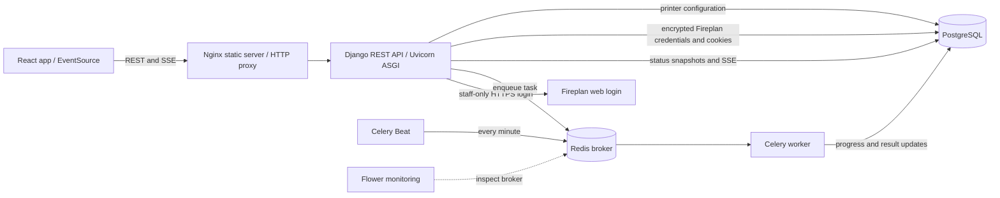

# Architecture

## Components

Vite serves the development UI and proxies `/api` to Django. Production builds the UI to static assets and serves them with Nginx. Nginx routes `/api/` and `/admin/` to Uvicorn and serves SPA routes with the static app. An optional Caddy overlay terminates HTTPS; the default production port is plain HTTP for trusted local networks.

## Technology choices

- React, Vite, TypeScript strict mode, Tailwind CSS, and local shadcn-style primitives. A global zero-radius rule guarantees square corners, including third-party widgets.
- Django and DRF provide the API, session authentication, CSRF protection, and admin. Uvicorn serves Django's ASGI application.
- PostgreSQL is the only persistent application database. Redis is the Celery broker with append-only persistence enabled.
- Celery executes tasks; `django-celery-results` stores Celery status/result metadata in PostgreSQL; `celery-progress` records progress in the Celery result backend; Flower monitors workers and broker activity.
- SSE uses Django's ASGI `StreamingHttpResponse`; it does not use a separate event broker or event table.

## API architecture

All API routes are same-origin under `/api`. Vite proxies requests in development; the production Nginx container proxies the same prefix to Uvicorn. Session authentication is used so native `EventSource` can send the session cookie without custom headers. Django's CSRF endpoint issues a token, and login/logout POST requests send it back in `X-CSRFToken`.

| Method | Route | Purpose |
| --- | --- | --- |
| GET | `/api/auth/csrf/` | Issue CSRF cookie/token |
| POST | `/api/auth/login/` | Create authenticated session |
| POST | `/api/auth/logout/` | End session |
| GET | `/api/auth/me/` | Read current session |
| POST | `/api/tasks/` | Start example task; return Celery ID |
| GET | `/api/tasks/` | List up to 50 recent example and Fireplan sync tasks |
| GET | `/api/tasks/{id}/` | Retrieve task snapshot |
| GET | `/api/tasks/{id}/events/` | Stream task snapshots as SSE |
| GET, POST | `/api/pagers/` | List pagers or create a pager |
| GET, PUT, PATCH, DELETE | `/api/pagers/{id}/` | Retrieve, edit, or delete a pager |
| POST | `/api/pagers/scanlookup/` | Resolve a scanned Fireplan QR URL against complete stored pager URLs; authenticated |
| GET | `/api/pager-types/` | List configured pager types |
| GET, POST | `/api/ric-codes/` | List or create standalone RiC/AdC code records |
| GET, PUT, PATCH, DELETE | `/api/ric-codes/{id}/` | Retrieve, edit, or delete a RiC/AdC code record |
| GET, PUT | `/api/fireplan/credentials/` | Read or save Fireplan login settings; staff only |
| POST | `/api/fireplan/test-login/` | Reuse or renew Fireplan session; staff only |
| POST | `/api/fireplan/sync-pagers/` | Queue Fireplan pager synchronization; staff only |
| GET, POST | `/api/printers/` | List or create printer configurations; staff only |
| GET, PUT, PATCH, DELETE | `/api/printers/{id}/` | Retrieve, edit, or delete a printer configuration; staff only |
| POST | `/api/printers/{id}/check-connection/` | Check TCP reachability with a two-second timeout; staff only |
| POST | `/api/printers/{id}/print-test-label/` | Send a name-and-time test label through the configured Brother driver; staff only |
| GET | `/api/citygis/` | Read vehicles, vectors, status catalog, and synchronization state; staff only |
| GET | `/api/citygis/vectors/{id}/status-history/` | Read the latest 50 status episodes for a vector, including start and duration; staff only |
| POST | `/api/citygis/refresh/` | Queue an immediate CityGIS refresh and return its Celery task ID; staff only |
| GET | `/api/citygis/events/` | Stream changed CityGIS snapshots over SSE; staff only |
| GET, POST | `/api/locations/` | List or create locations; staff only |
| GET, PUT, PATCH, DELETE | `/api/locations/{id}/` | Read, update, or delete a location; staff only |
| GET | `/api/locations/services/` | List normalized CityGIS services and their mapped location IDs; staff only |
| GET | `/api/locations/{id}/overview/` | Read a location, mapped service, and current vectors with status and linked vehicle; staff only |
| GET | `/api/inventory/` | Read locations, vectors, pagers, and current RiC/AdC links; staff only |
| PUT | `/api/inventory/pagers/{id}/vector/` | Assign a pager to a vector or close its active assignment with `vector_id: null`; staff only |
| PUT | `/api/inventory/ric-codes/{id}/vector/` | Assign a RiC/AdC record to a vector or close its active link with `vector_id: null`; staff only |
| GET | `/api/schema/` | OpenAPI schema |
| GET | `/api/docs/` | Swagger UI |

The starter is single-tenant: authenticated accounts share the demonstration task list. No ownership table is added. Add explicit task ownership and query scoping before adapting the code to a multi-user product.

## Pager assets

The `assets` Django app stores pagers in this application's PostgreSQL database. `Pager` and `PagerType` use the `pager_assets` and `pager_types` tables. A pager has a unique serial number, a protected foreign key to `PagerType`, and optional unique Fireplan ID and QR URL fields.

The standalone `RicCode` model in the `ric_codes` table stores RiC/AdC pairs and an operator-facing alias such as `A HELI 1`; records are not linked to pager assets. The RiC is the code broadcast through POCSAG and matched by pagers. The associated AdC is supplied to ASTRID to identify the pager to alert. Both codes are stored as digit strings so formatting is preserved. A database constraint makes the pair unique; repeated RiC or AdC values with a different counterpart are not currently prohibited. The initial register is loaded by a data migration. The application does not submit alerts or transmit POCSAG messages.

Authenticated users can manage pagers and their codes through the REST API and frontend asset list. The pager and RiC/AdC list panels place a search field beside the title and record count. Pager search checks serial number and type; RiC/AdC search checks both codes and alias. Search applies together with sorting. Both tables have header bands that span the panel width, compact title-case labels, medium-weight sort controls, and stable column widths. Pager rows sort by serial number or type; RiC/AdC rows sort by either code or alias. Inactive sort controls show a neutral icon; the active control shows the sort direction and exposes `aria-sort`. Text ordering is locale-aware, case-insensitive, and numeric-aware, with the record ID as a stable tie-breaker. Action columns are not sortable. The pager page offers staff a Fireplan sync action; its Celery task runs independently of navigation, and the last sync ID is saved in browser local storage. The API returns the linked type as an object and accepts `type_id` for create/edit operations; Fireplan metadata is read-only. Deleting a type referenced by a pager is prevented by the database relationship. Pagers, Fireplan vehicles, and CityGIS vectors now have a shared `inventory.ManagedObject` identity with explicit kinds; their specific fields remain on `Pager`, `Vehicle`, and `Vector`.

Synchronization imports only exact model names configured in `PagerType`, matches first by serial number and later by Fireplan ID, and retains local-only records. Its persisted task report includes added, updated, unchanged, and per-record errors. The UI shows live progress and opens the saved report from task detail; completion uses a bottom-right toast. The QR URL comes from Fireplan and is stored verbatim. QR generation and physical label printing remain outside the synchronization module.

Pager scans are handled by the authenticated `POST /api/pagers/scanlookup/` endpoint. The backend preserves the raw scan, recognizes the Fireplan QR URL shape, and tries the original plus documented AZERTY/QWERTY keyboard-layout candidates, including scans where the URL characters and shifted number-row symbols are both remapped. A match requires equality with the complete stored QR URL; the lookup does not extract or search by Fireplan ID. The reusable React control accepts a one-shot keyboard-wedge scan; its icon turns red while active, and clicking or moving focus outside the control deactivates the mode. Camera scans use `@zxing/browser` after a camera-button action. The camera is stopped after one decoded value, cancellation, or component unmount. In a vector relationship dialog, the UI checks the current inventory snapshot and only assigns a pager with no active vector; it never moves an already assigned pager. Camera access is subject to secure-context browser rules.

## Label printers

The separate `printers` Django app stores configurations in the `label_printers` PostgreSQL table. A printer record contains a management name, manufacturer, model, IP address, TCP port (default `9100`), and default tape width (default `12 mm`). The initial API validation supports only Brother PT-P900W and continuous tape widths of 6, 12, 18, 24, or 36 mm. Staff can use the CRUD endpoints, check the saved IP and port using a two-second TCP timeout, and send a text test label with the saved name, local time, model, address, port, and tape width. A reachability result does not confirm printer readiness, and a successful driver call does not prove that a physical label was produced. The React page is available at `/labelprinters` under the staff-only **Beheer → Labelprinters** area. Manufacturer and model are stored as fields, but adding another printer model still requires application validation and driver support. The print service uses `brother-label==2.0a8` and Pillow; license and manual proof-print status are documented in `docs/label-printer-dependencies.md`.

The separate `fireplan` Django app stores settings in the singleton `FireplanCredential` row. The password and serialized cookie jar are encrypted with Fernet using `FIREPLAN_CREDENTIAL_KEY`, which must be supplied from the environment and backed up separately from the database. The staff-only API never returns either secret. The Fireplan client first checks a saved cookie jar against `/fr/`; when the protected profile link is absent, it performs the documented CSRF form login and saves the refreshed cookie jar. Requests require HTTPS, validate the certificate chain, and reject redirects to another origin. Hostname validation stays enabled unless `FIREPLAN_ALLOW_CERTIFICATE_HOSTNAME_MISMATCH=true` is explicitly set for an internal alias; session cookies are sent only to the configured Fireplan origin. Pager synchronization reads the Fireplan QR inventory in batches of up to 500 and follows the reported total. It imports only names configured in `PagerType`, links first by serial number and later by stored Fireplan ID, and retains local-only pagers. The staff-only start endpoint returns the Celery task ID; progress and its added, updated, unchanged, and row-error report use the existing task-result backend. The frontend retains the active sync ID, reconnects through SSE, and shows a bottom-right completion toast with a report action.

The Fireplan inventory mapping in `fireplan/inventory_mapping.yaml` selects the exact French container name `Cabine de conduite` and item type ID `1010`, validating its readable type name. The container UUID is resolved from each inventory tree before item retrieval; the full tree is not stored by the mapping. Naive source timestamps are assigned `Europe/Brussels`, while explicit offsets are preserved. `updatedAt` is present in the source list, but its behavior when a closed inventory's contents change has not been confirmed; automatic synchronization must not assume it is a reliable change detector or fetch all detail trees hourly. PyYAML is used through `safe_load` because Python's standard library has no YAML parser; see `docs/fireplan-inventory-dependencies.md`.

`FireplanInventory` stores each closed inventory's source metadata, original vehicle code, available status flags, selected radio JSON, mapping version, synchronization status, last attempt/success, and last error. Its optional vehicle and vector links are resolved from an exact unique vehicle alphacode and the `VectorVehicleHistory` interval containing the aware inventory `closedAt`; unknown matches remain null. `FireplanRadioObservation` stores each mapped FirePlan item ID and TEI as text, with uniqueness per inventory/item. `fireplan.sync_inventories` scans paginated summaries hourly and fetches details for new, failed, or mapping-version-stale inventories; a manual date period forces detail retrieval for every included inventory. Source detail and observations are replaced together only after a complete successful fetch and validation. The hourly run does not treat `updatedAt` as a reliable content-change signal. Scheduled task results are ignored; manual runs retain the normal task ID, progress, result, and SSE reporting path.

## CityGIS

`LastStatusTimeUpdated` values without an explicit offset are interpreted as UTC.

`VectorStatusHistory` stores each observed status episode separately from the current vector projection. A changed status closes the previous episode at the new source-effective status timestamp, or at the synchronization observation time when the source timestamp is absent; repeated unchanged snapshots do not add records. The staff-only `/api/citygis/vectors/{id}/status-history/` endpoint returns the latest 50 episodes with catalog labels/colors, start time, and duration. The source exposes only its current status, so transitions that occur and reverse between one-minute polls can be missed; a migration seeds one current episode from each existing vector, and earlier status episodes cannot be reconstructed.

The `citygis` Django app stores physical Fireplan vehicles, individual resources-service vector records, and the four-field status catalog separately. Vectors preserve raw string status codes, source timestamps, and their independent `ResourceCode`/`pResourceCode` identifiers. Matching uses trimmed, case-insensitive vehicle names and Fireplan `alphacode`; duplicate vector matches are logged as errors and only the first source-order match is linked. Missing records remain stored and are marked no longer current. Resources-service rows without a usable `pResourceCode` are logged and excluded because they cannot identify a vector. A coded vector with no valid `StatusCode` is retained with an empty raw code, logged, and shown as unknown.

Celery Beat queues `citygis.refresh` once per minute. Its scheduled runs ignore Celery results; manual staff refreshes return the normal Celery task ID. The task reuses the encrypted Fireplan username/password to log in to the resources service at `CITYGIS_RESOURCES_BASE_URL`, then fetches the resources records. A singleton synchronization state stores last attempt, last success, and a secret-safe error message. Source failures leave the last successful records intact.

CityGIS services are normalized by abbreviation, and the original service abbreviation stays on each vector for source matching. `Location` records support a parent hierarchy and can map one service; `Vector.post` is derived only when that mapping points to a post. Vectors remain stable when their current Fireplan vehicle changes. The staff-only React page reads `/api/citygis/`, starts a manual refresh through `/api/citygis/refresh/`, and receives complete changed snapshots from `/api/citygis/events/`. SSE compares database snapshots once per second, sends the initial snapshot immediately, and emits keep-alive comments every 15 seconds. It reuses Django session authentication and the existing SSE approach; no separate event log or event bus is added.

Staff manage the existing hierarchy at `/locations` under **Beheer → Locaties**. The model remains `Location` for posts, buildings, rooms, and other locations. Add-location, add-child, edit, and delete actions use square icon-only buttons with descriptive accessible names and hover titles. Staff-only `/api/locations/` endpoints accept only local fields (`name`, `sort_name`, `kind`, `parent_id`, and `service_id`); parents cannot be self or descendants, and only posts can map a service. The optional `sort_name` is edited under a collapsed-by-default advanced section. Within each hierarchy level, populated sort names are ordered first alphabetically, then by location name; blank sort names come last and use location name. The read-only `/api/locations/services/` endpoint lists the synchronized catalogue and current mapping. Deletion is rejected when a location has children or a mapped service. `/api/locations/{id}/overview/` returns the selected location, its mapped service or `null`, and only current vectors for that service with catalog status and their current Fireplan vehicle link. A vehicle-to-post association is not stored separately. Physical asset placement, location observations, inventory checks, and discrepancy workflows remain outside this page.

`ManagedRelationship` stores typed object-to-object relationships and keeps prior operational assignments; a conditional database constraint allows one active assignment per source asset. `PhysicalLocationObservation` stores where and when an asset was observed, separately from assignment. An object's expected physical location is derived through its active assignment and, for a vector, its current CityGIS vehicle; it is not stored as an observation. `RicCodeVectorRelationship` keeps RiC/AdC-to-vector assignment history and permits multiple codes per vector while limiting each code to one active vector.

The staff-only **Inventaris** page reads `/api/inventory/`. Staff choose Pagers, Vectors, or RiC/AdC in a searchable list with compact title-case headers, muted full-width header bands, fixed column geometry, and sortable data columns. Inactive columns show a neutral sort icon; the active column shows its direction and `aria-sort`. Vector rows separate vector, service, post, vehicle, and color-coded status into aligned columns; RiC/AdC rows show alias, both codes, and linked vector. Selecting an object opens its relationship modal: pager and RiC/AdC links use a searchable single-vector choice with a dropdown below and outside the content-sized modal, while vector links use two searchable columns for available and linked pagers or codes. Inactive CityGIS vectors are omitted from new choices, but an existing inactive link remains available to unlink. CityGIS service/status and Fireplan vehicle values are display-only. Pager links use `ManagedRelationship`; RiC/AdC links use `RicCodeVectorRelationship`. The two PUT endpoints accept only `vector_id`, and `null` closes the current link. The page edits application-owned links only; physical-location observations and inventory checks remain out of scope.

## Database and task result architecture

Django connects to PostgreSQL using `DATABASE_URL`. Django migrations create the framework tables and the `django_celery_results_taskresult` table. The Celery result backend is `django-db`, so task IDs, states, progress metadata, tracebacks, and final results are stored there. There is no parallel task model.

The API uses Celery's task ID directly. A newly queued task can report `PENDING` until a worker records a state. The task list reads recent `TaskResult` rows named `tasks.example_task`, `fireplan.sync_pagers`, `fireplan.sync_inventories`, or `citygis.refresh`; the currently active IDs are kept in browser local storage so a route can be restored after navigation or refresh. There is no result-cleanup scheduler in the starter, so rows remain stored until an application-specific cleanup policy is added. `CELERY_RESULT_EXPIRES` does not remove rows by itself without Celery Beat or another cleanup schedule.

## Task execution and recovery

The task uses `ProgressRecorder.set_progress()` once per second. The demonstration task defaults to 30 seconds and is idempotent. Celery is configured with concurrency two, prefetch one, late acknowledgements, worker-loss rejection, a soft limit of 60 seconds, a hard limit of 90 seconds, and bounded automatic retries for `RuntimeError`.

On a normal SIGTERM, Celery performs a warm shutdown and attempts to finish active tasks. Watchfiles triggers a worker restart on Python source changes and allows up to 120 seconds for a graceful stop; Compose also grants the worker a two-minute shutdown window. If a worker is forcibly killed after the configured 90-second hard limit, a late-acknowledged task can be redelivered and run again from its beginning. That is at-least-once delivery, not restoration of the prior stack or progress point; real tasks must be idempotent. Redis AOF and Docker restart policies improve recovery of queued work, but are not a substitute for backups or task-specific recovery.

There is no cancellation API. Celery revoke without termination can prevent some queued tasks from starting, but cannot safely stop arbitrary work already in progress. The starter does not imply otherwise.

## Progress and SSE

`celery-progress` records the current/total/percentage in Celery task metadata. The configured `django-celery-results` backend stores that metadata in PostgreSQL. SSE reads the same Celery snapshot and emits it when it changes. While a client is connected, Django checks the stored snapshot once per second; it does not write a second event log or broadcast topic. The per-connection query interval is intentionally simple for a starter and should be tuned for large numbers of simultaneous connections.

The browser uses native `EventSource`, which reconnects automatically. On every connection the stream immediately sends the latest snapshot, so reconnect does not require replaying an event log. The stream emits keep-alive comments every 15 seconds, disables Nginx response buffering, and closes after a terminal state. Navigating away closes only the SSE connection; it does not affect the Celery task. Refreshing the detail route retrieves the stored status and opens a new stream.

## Docker environments

Development overrides the image targets and mounts source into API/worker/frontend containers. The Vite frontend and optional Flower UI publish host ports on loopback, configurable through `FRONTEND_PORT` and `FLOWER_PORT` (defaults 5174 and 5556). The base Compose app-port mapping is also configurable through `APP_PORT` (default 8081). Django, PostgreSQL, and Redis remain on the Compose network at `api:8000`, `db:5432`, and `redis:6379`; these internal ports do not change. Vite HMR, Uvicorn `--reload`, and Watchfiles are enabled. PostgreSQL and Redis use named volumes. `make stop` retains these volumes. Each concurrently running checkout needs distinct values for every published host port in its `.env`.

Production uses optimized frontend assets, Uvicorn workers, Celery workers, PostgreSQL, Redis, and healthchecks. Services restart unless stopped. Only the Nginx frontend publishes the app port by default, configurable with `APP_PORT` (default 8081); databases and broker are private. Optional Flower is profile-gated, loopback-bound, and requires basic-auth credentials; its host port is configurable with `FLOWER_PORT` (default 5556). Optional Caddy publishes host ports configured by `HTTP_PORT` and `HTTPS_PORT` (defaults 8082 and 8444) to its unchanged container ports 80 and 443, and stores certificate state in Docker volumes. Assign unique host port values in each checkout's `.env` when running multiple projects concurrently.

## Security

- No production credentials are checked in. `.env` is ignored; replace sample Django and database values before use.
- The API requires authenticated sessions. Login/logout are CSRF-protected. Same-origin routing avoids permissive CORS configuration.
- Production defaults to plain HTTP for trusted LAN use, so session and CSRF cookies are non-secure by default. If HTTPS is enabled, set `DJANGO_SECURE_COOKIES=true` to mark them Secure and configure `HTTPS_DOMAIN`/certificate trust appropriately.
- Django debug is off unless explicitly enabled. Allowed hosts are environment-configured. The demo account command refuses to run when `DJANGO_DEBUG` is not true.
- Flower is not published to a public interface; production monitoring is opt-in, authenticated, and loopback-only.
- This single-tenant example does not enforce per-user task ownership. Do not deploy it as a multi-tenant product without adding authorization scope.

## Failure handling

Task exceptions become Celery failure states and are visible in the API and Flower. Runtime errors retry with bounded exponential backoff and jitter; other exceptions fail without automatic retry. Task time limits prevent indefinitely running example tasks. Logs are emitted as structured JSON to container stdout/stderr.

PostgreSQL remains the authoritative store for status, progress, results, and failure tracebacks. Redis stores queued broker messages; its AOF volume and service restart policy help retain them across process/container restarts. A worker lost with an unacknowledged task may cause re-execution; a task is never described as automatically resuming at the last progress update. Tasks whose failure is recorded can be found in the task list and Flower. A message lost through an unrecoverable Redis-volume loss cannot be recovered by PostgreSQL because a result row exists only after a worker records task state.
