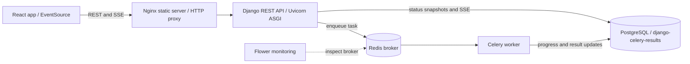

# Architecture

## Components

Vite serves the development UI and proxies `/api` to Django. Production builds the UI to static assets and serves them with Nginx. Nginx routes `/api/` and `/admin/` to Uvicorn and serves SPA routes with the static app. An optional Caddy overlay terminates HTTPS; the default production port is plain HTTP for trusted local networks.

## Technology choices

- React, Vite, TypeScript strict mode, Tailwind CSS, and local shadcn-style primitives. A global zero-radius rule guarantees square corners, including third-party widgets.
- Django and DRF provide the API, session authentication, CSRF protection, and admin. Uvicorn serves Django's ASGI application.
- PostgreSQL is the only persistent application database. Redis is the Celery broker with append-only persistence enabled.
- Celery executes tasks; `django-celery-results` stores Celery status/result metadata in PostgreSQL; `celery-progress` records progress in the Celery result backend; Flower monitors workers and broker activity.
- SSE uses Django's ASGI `StreamingHttpResponse`; it does not use a separate event broker or event table.

## API architecture

All API routes are same-origin under `/api`. Vite proxies requests in development; the production Nginx container proxies the same prefix to Uvicorn. Session authentication is used so native `EventSource` can send the session cookie without custom headers. Django's CSRF endpoint issues a token, and login/logout POST requests send it back in `X-CSRFToken`.

| Method | Route | Purpose |
| --- | --- | --- |
| GET | `/api/auth/csrf/` | Issue CSRF cookie/token |
| POST | `/api/auth/login/` | Create authenticated session |
| POST | `/api/auth/logout/` | End session |
| GET | `/api/auth/me/` | Read current session |
| POST | `/api/tasks/` | Start example task; return Celery ID |
| GET | `/api/tasks/` | List up to 50 recent example tasks |
| GET | `/api/tasks/{id}/` | Retrieve task snapshot |
| GET | `/api/tasks/{id}/events/` | Stream task snapshots as SSE |
| GET | `/api/schema/` | OpenAPI schema |
| GET | `/api/docs/` | Swagger UI |

The starter is single-tenant: authenticated accounts share the demonstration task list. No ownership table is added. Add explicit task ownership and query scoping before adapting the code to a multi-user product.

## Database and task result architecture

Django connects to PostgreSQL using `DATABASE_URL`. Django migrations create the framework tables and the `django_celery_results_taskresult` table. The Celery result backend is `django-db`, so task IDs, states, progress metadata, tracebacks, and final results are stored there. There is no parallel task model.

The API uses Celery's task ID directly. A newly queued task can report `PENDING` until a worker records a state. The task list reads recent `TaskResult` rows named `tasks.example_task`; the currently active ID is also kept in browser local storage so a route can be restored after navigation or refresh. There is no result-cleanup scheduler in the starter, so rows remain stored until an application-specific cleanup policy is added. `CELERY_RESULT_EXPIRES` does not remove rows by itself without Celery Beat or another cleanup schedule.

## Task execution and recovery

The task uses `ProgressRecorder.set_progress()` once per second. The demonstration task defaults to 30 seconds and is idempotent. Celery is configured with concurrency two, prefetch one, late acknowledgements, worker-loss rejection, a soft limit of 60 seconds, a hard limit of 90 seconds, and bounded automatic retries for `RuntimeError`.

On a normal SIGTERM, Celery performs a warm shutdown and attempts to finish active tasks. Watchfiles triggers a worker restart on Python source changes and allows up to 120 seconds for a graceful stop; Compose also grants the worker a two-minute shutdown window. If a worker is forcibly killed after the configured 90-second hard limit, a late-acknowledged task can be redelivered and run again from its beginning. That is at-least-once delivery, not restoration of the prior stack or progress point; real tasks must be idempotent. Redis AOF and Docker restart policies improve recovery of queued work, but are not a substitute for backups or task-specific recovery.

There is no cancellation API. Celery revoke without termination can prevent some queued tasks from starting, but cannot safely stop arbitrary work already in progress. The starter does not imply otherwise.

## Progress and SSE

`celery-progress` records the current/total/percentage in Celery task metadata. The configured `django-celery-results` backend stores that metadata in PostgreSQL. SSE reads the same Celery snapshot and emits it when it changes. While a client is connected, Django checks the stored snapshot once per second; it does not write a second event log or broadcast topic. The per-connection query interval is intentionally simple for a starter and should be tuned for large numbers of simultaneous connections.

The browser uses native `EventSource`, which reconnects automatically. On every connection the stream immediately sends the latest snapshot, so reconnect does not require replaying an event log. The stream emits keep-alive comments every 15 seconds, disables Nginx response buffering, and closes after a terminal state. Navigating away closes only the SSE connection; it does not affect the Celery task. Refreshing the detail route retrieves the stored status and opens a new stream.

## Docker environments

Development overrides the image targets and mounts source into API/worker/frontend containers. Only the Vite frontend and optional Flower UI publish host ports, both on loopback and configurable through `FRONTEND_PORT` and `FLOWER_PORT`. Django, PostgreSQL, and Redis remain on the Compose network at `api:8000`, `db:5432`, and `redis:6379`. Vite HMR, Uvicorn `--reload`, and Watchfiles are enabled. PostgreSQL and Redis use named volumes. `make stop` retains these volumes.

Production uses optimized frontend assets, Uvicorn workers, Celery workers, PostgreSQL, Redis, and healthchecks. Services restart unless stopped. Only the Nginx frontend publishes the app port by default, configurable with `APP_PORT`; databases and broker are private. Optional Flower is profile-gated, loopback-bound, and requires basic-auth credentials; its host port is configurable with `FLOWER_PORT`. Optional Caddy publishes ports configured by `HTTP_PORT` and `HTTPS_PORT` (defaults 80/443) and stores certificate state in Docker volumes.

## Security

- No production credentials are checked in. `.env` is ignored; replace sample Django and database values before use.
- The API requires authenticated sessions. Login/logout are CSRF-protected. Same-origin routing avoids permissive CORS configuration.
- Production defaults to plain HTTP for trusted LAN use, so session and CSRF cookies are non-secure by default. If HTTPS is enabled, set `DJANGO_SECURE_COOKIES=true` to mark them Secure and configure `HTTPS_DOMAIN`/certificate trust appropriately.
- Django debug is off unless explicitly enabled. Allowed hosts are environment-configured. The demo account command refuses to run when `DJANGO_DEBUG` is not true.
- Flower is not published to a public interface; production monitoring is opt-in, authenticated, and loopback-only.
- This single-tenant example does not enforce per-user task ownership. Do not deploy it as a multi-tenant product without adding authorization scope.

## Failure handling

Task exceptions become Celery failure states and are visible in the API and Flower. Runtime errors retry with bounded exponential backoff and jitter; other exceptions fail without automatic retry. Task time limits prevent indefinitely running example tasks. Logs are emitted as structured JSON to container stdout/stderr.

PostgreSQL remains the authoritative store for status, progress, results, and failure tracebacks. Redis stores queued broker messages; its AOF volume and service restart policy help retain them across process/container restarts. A worker lost with an unacknowledged task may cause re-execution; a task is never described as automatically resuming at the last progress update. Tasks whose failure is recorded can be found in the task list and Flower. A message lost through an unrecoverable Redis-volume loss cannot be recovered by PostgreSQL because a result row exists only after a worker records task state.
